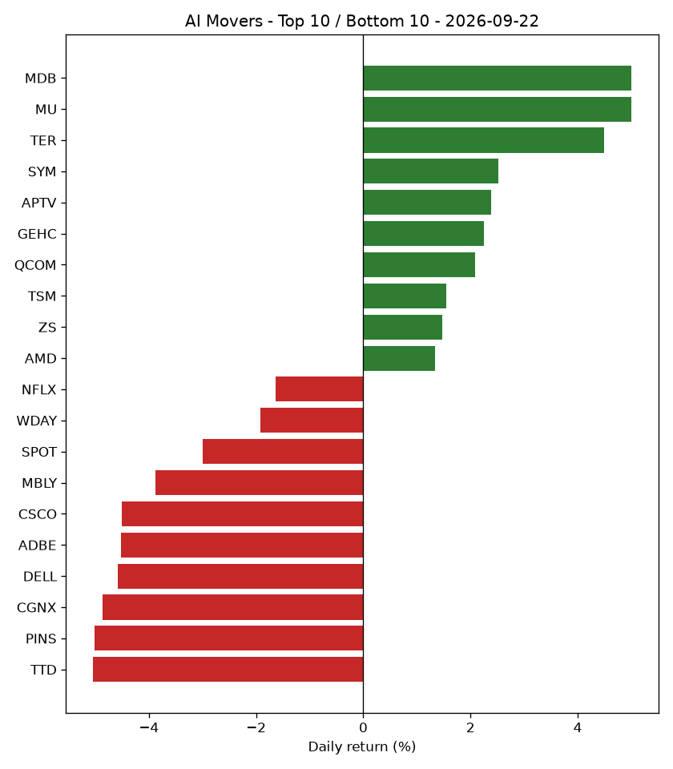

# AI Market Recap - 2026-09-22

## Market Overview

Market breadth showed 24 stocks up, 26 stocks down, and 0 stocks flat out of 50 total stocks tracked, while the S&P 500 (SPY) returned -0.02%.

## Top Themes

AI Chips & Semiconductors led the top themes with a +1.86% return while remaining at rank 1, followed by AI Data & Analytics which returned +0.94% and moved from rank 10 to rank 2.

| Theme | Return | 5d Trend | Rank | Prev Rank |
|---|---|---|---|---|
| AI Chips & Semiconductors | +1.86% | +12.00% | 1 | 1 |
| AI Data & Analytics | +0.94% | +6.05% | 2 | 10 |
| Robotics & Industrial Automation | +0.56% | +6.78% | 3 | 2 |
| Cybersecurity AI | +0.43% | +2.81% | 4 | 8 |
| Healthcare AI | -0.05% | +4.03% | 5 | 7 |

## Bottom Themes

Consumer Internet & AI Platforms lagged with a -3.06% return, moving from rank 9 to rank 10, while AI Networking & Data Center Infrastructure returned -1.60% and fell from rank 3 to rank 9.

| Theme | Return | 5d Trend | Rank | Prev Rank |
|---|---|---|---|---|
| Consumer Internet & AI Platforms | -3.06% | -4.36% | 10 | 9 |
| AI Networking & Data Center Infrastructure | -1.60% | +3.47% | 9 | 3 |
| Enterprise AI Software | -1.44% | -2.77% | 8 | 6 |
| Cloud & AI Infrastructure | -0.59% | +0.81% | 7 | 4 |
| Autonomous Vehicles & Mobility AI | -0.49% | +0.16% | 6 | 5 |

## Top Stocks

MDB led the top stocks with a +5.01% return as it moved from rank 36 to rank 1, followed by MU which gained +5.00% and held rank 2.

| Ticker | Theme | Return | 5d Trend | High | Low | Volume | Rank | Prev Rank |
|---|---|---|---|---|---|---|---|---|
| MDB | AI Data & Analytics | +5.01% | +13.24% | $439.75 | $406.66 | 2,113,658 | 1 | 36 |
| MU | AI Chips & Semiconductors | +5.00% | +18.17% | $1097.25 | $1030.02 | 29,161,039 | 2 | 2 |
| TER | Robotics & Industrial Automation | +4.49% | +19.78% | $399.40 | $370.45 | 2,317,993 | 3 | 1 |
| SYM | Robotics & Industrial Automation | +2.53% | +5.38% | $45.64 | $43.70 | 1,992,829 | 4 | 50 |
| APTV | Autonomous Vehicles & Mobility AI | +2.39% | +1.97% | $44.98 | $43.71 | 4,084,471 | 5 | 15 |
| GEHC | Healthcare AI | +2.25% | +3.43% | $67.09 | $66.00 | 3,941,475 | 6 | 20 |
| QCOM | AI Chips & Semiconductors | +2.08% | +5.58% | $199.15 | $191.66 | 11,458,760 | 7 | 49 |
| TSM | AI Chips & Semiconductors | +1.54% | +9.24% | $452.88 | $441.20 | 11,246,428 | 8 | 11 |
| ZS | Cybersecurity AI | +1.47% | +8.40% | $210.73 | $202.55 | 2,904,446 | 9 | 17 |
| AMD | AI Chips & Semiconductors | +1.34% | +23.71% | $624.52 | $606.31 | 28,252,484 | 10 | 5 |

## Bottom Stocks

TTD was the lowest-performing stock with a -5.04% return, moving from rank 34 to rank 50, while PINS dropped -5.01% and moved from rank 7 to rank 49.

| Ticker | Theme | Return | 5d Trend | High | Low | Volume | Rank | Prev Rank |
|---|---|---|---|---|---|---|---|---|
| TTD | Consumer Internet & AI Platforms | -5.04% | -12.13% | $14.04 | $13.15 | 29,571,025 | 50 | 34 |
| PINS | Consumer Internet & AI Platforms | -5.01% | -1.97% | $19.77 | $18.25 | 22,420,211 | 49 | 7 |
| CGNX | Robotics & Industrial Automation | -4.87% | -0.30% | $63.39 | $58.08 | 2,417,381 | 48 | 10 |
| DELL | AI Networking & Data Center Infrastructure | -4.59% | +1.00% | $574.60 | $547.71 | 9,764,867 | 47 | 45 |
| ADBE | Enterprise AI Software | -4.52% | -7.57% | $254.67 | $237.69 | 7,365,487 | 46 | 26 |
| CSCO | AI Networking & Data Center Infrastructure | -4.50% | -3.30% | $110.43 | $104.51 | 32,882,542 | 45 | 23 |
| MBLY | Autonomous Vehicles & Mobility AI | -3.88% | -3.03% | $8.15 | $7.67 | 6,138,952 | 44 | 18 |
| SPOT | Consumer Internet & AI Platforms | -2.99% | -10.20% | $523.05 | $495.59 | 1,964,641 | 43 | 46 |
| WDAY | Enterprise AI Software | -1.92% | -1.28% | $197.00 | $187.72 | 1,977,578 | 42 | 38 |
| NFLX | Consumer Internet & AI Platforms | -1.64% | -7.37% | $73.76 | $71.58 | 34,353,550 | 41 | 47 |

