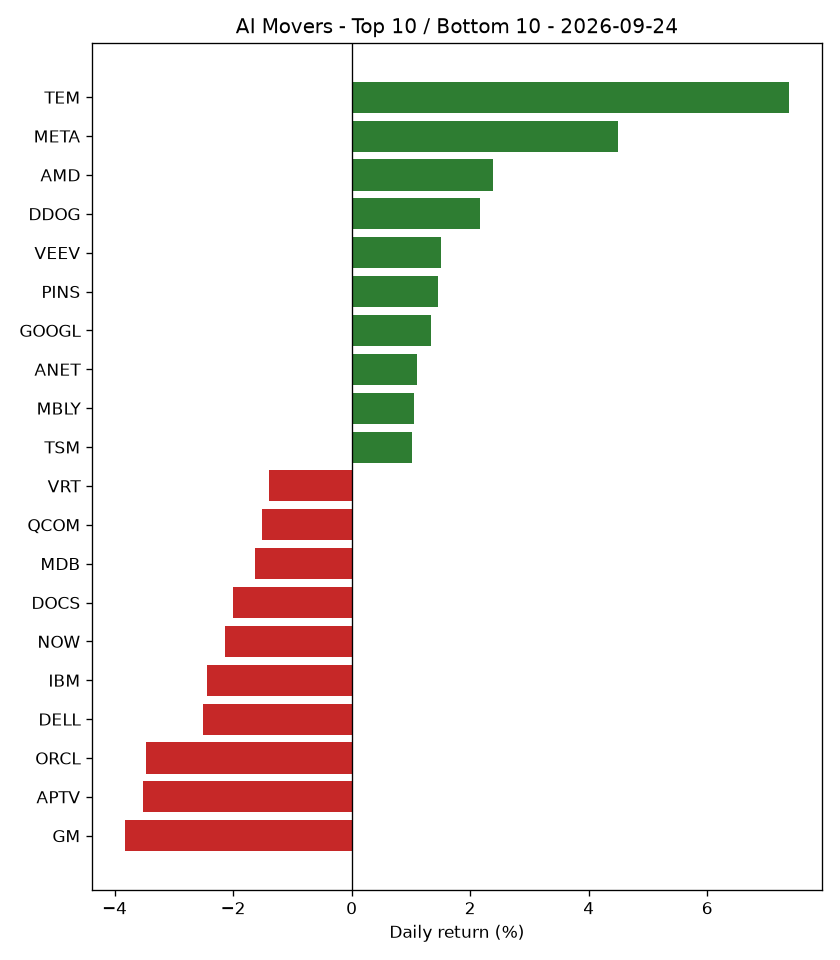

# AI Market Recap - 2026-09-24

## Market Overview

Out of 50 tracked AI stocks, 22 moved up, 27 moved down, and 1 remained flat, while the S&P 500 (SPY) returned -0.08%.

## Top Themes

Healthcare AI led the themes with a +1.83% return, moving from rank 5 to rank 1, while Consumer Internet & AI Platforms returned +1.25%, moving from rank 10 to rank 2.

| Theme | Return | 5d Trend | Rank | Prev Rank |
|---|---|---|---|---|
| Healthcare AI | +1.83% | +1.89% | 1 | 5 |
| Consumer Internet & AI Platforms | +1.25% | -0.66% | 2 | 10 |
| AI Chips & Semiconductors | +0.16% | +6.17% | 3 | 1 |
| Robotics & Industrial Automation | -0.02% | +2.62% | 4 | 3 |
| AI Data & Analytics | -0.13% | +3.42% | 5 | 2 |

## Bottom Themes

Autonomous Vehicles & Mobility AI was the lowest-performing theme with a -1.43% return, moving from rank 6 to rank 10, while Cloud & AI Infrastructure fell -1.01%, moving from rank 7 to rank 9.

| Theme | Return | 5d Trend | Rank | Prev Rank |
|---|---|---|---|---|
| Autonomous Vehicles & Mobility AI | -1.43% | -2.11% | 10 | 6 |
| Cloud & AI Infrastructure | -1.01% | -2.79% | 9 | 7 |
| Enterprise AI Software | -0.58% | -0.55% | 8 | 8 |
| AI Networking & Data Center Infrastructure | -0.52% | -1.27% | 7 | 9 |
| Cybersecurity AI | -0.48% | +5.06% | 6 | 4 |

## Top Stocks

TEM led individual stocks with a +7.38% return, moving from rank 36 to rank 1, while META rose +4.50%, moving from rank 32 to rank 2.

| Ticker | Theme | Return | 5d Trend | High | Low | Volume | Rank | Prev Rank |
|---|---|---|---|---|---|---|---|---|
| TEM | Healthcare AI | +7.38% | +2.34% | $82.46 | $74.81 | 10,813,991 | 1 | 36 |
| META | Consumer Internet & AI Platforms | +4.50% | +13.96% | $779.82 | $743.01 | 34,802,172 | 2 | 32 |
| AMD | AI Chips & Semiconductors | +2.38% | +15.44% | $630.80 | $599.24 | 25,332,940 | 3 | 10 |
| DDOG | AI Data & Analytics | +2.16% | +8.86% | $258.39 | $247.27 | 3,489,174 | 4 | 13 |
| VEEV | Healthcare AI | +1.51% | +4.20% | $276.24 | $270.68 | 1,379,945 | 5 | 26 |
| PINS | Consumer Internet & AI Platforms | +1.46% | +2.24% | $18.79 | $18.34 | 11,760,105 | 6 | 49 |
| GOOGL | Cloud & AI Infrastructure | +1.34% | -1.43% | $343.09 | $336.02 | 23,770,627 | 7 | 35 |
| ANET | AI Networking & Data Center Infrastructure | +1.10% | +3.09% | $206.54 | $198.76 | 3,558,936 | 8 | 25 |
| MBLY | Autonomous Vehicles & Mobility AI | +1.05% | -4.35% | $7.87 | $7.56 | 8,870,301 | 9 | 44 |
| TSM | AI Chips & Semiconductors | +1.03% | +4.86% | $452.56 | $440.60 | 7,716,071 | 10 | 8 |

## Bottom Stocks

GM lagged individual stocks with a -3.82% return, moving from rank 31 to rank 50, while APTV fell -3.52%, moving from rank 5 to rank 49.

| Ticker | Theme | Return | 5d Trend | High | Low | Volume | Rank | Prev Rank |
|---|---|---|---|---|---|---|---|---|
| GM | Autonomous Vehicles & Mobility AI | -3.82% | -6.98% | $83.70 | $80.04 | 7,935,491 | 50 | 31 |
| APTV | Autonomous Vehicles & Mobility AI | -3.52% | -0.09% | $45.25 | $43.27 | 3,789,183 | 49 | 5 |
| ORCL | Cloud & AI Infrastructure | -3.47% | -7.34% | $140.34 | $133.48 | 56,602,190 | 48 | 19 |
| DELL | AI Networking & Data Center Infrastructure | -2.51% | -8.90% | $549.85 | $530.45 | 7,956,496 | 47 | 47 |
| IBM | Cloud & AI Infrastructure | -2.45% | -4.50% | $232.62 | $226.01 | 4,148,619 | 46 | 27 |
| NOW | Enterprise AI Software | -2.13% | -0.50% | $141.04 | $137.53 | 9,576,643 | 45 | 28 |
| DOCS | Healthcare AI | -1.99% | -1.99% | $26.96 | $26.03 | 2,470,553 | 44 | 37 |
| MDB | AI Data & Analytics | -1.62% | +7.11% | $427.00 | $416.39 | 1,204,730 | 43 | 1 |
| QCOM | AI Chips & Semiconductors | -1.51% | +2.94% | $196.77 | $191.75 | 9,084,936 | 42 | 7 |
| VRT | AI Networking & Data Center Infrastructure | -1.40% | +1.58% | $246.90 | $239.00 | 4,126,768 | 41 | 12 |

