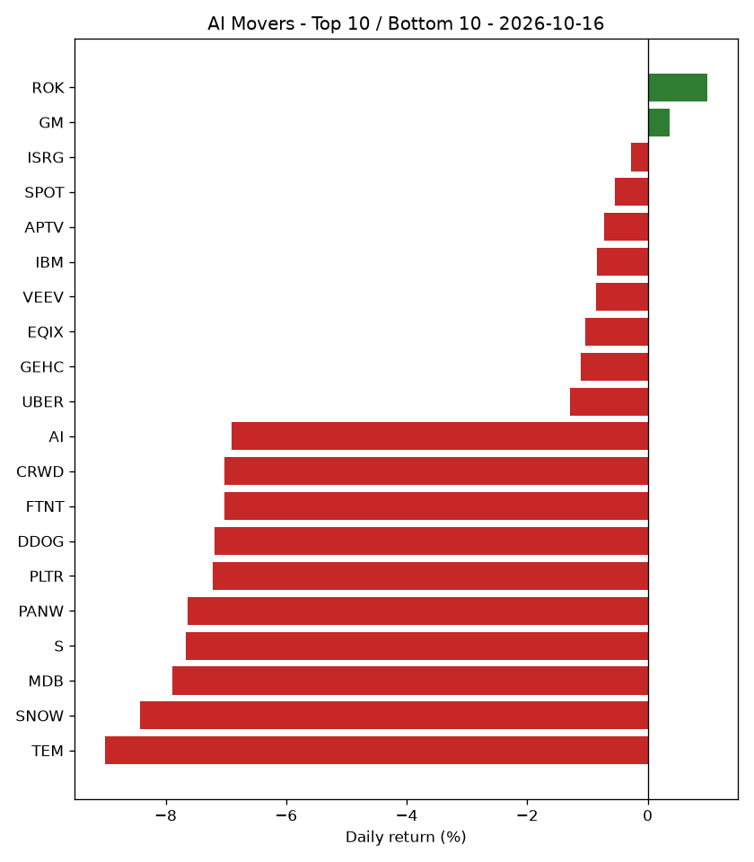

# AI Market Recap - 2026-10-16

## Market Overview

Market breadth showed 2 stocks up and 48 stocks down out of 50 total tracked, while the S&P 500 (SPY) returned -1.11%.

## Top Themes

Autonomous Vehicles & Mobility AI was the top-performing theme with a return of -1.32%, followed by Robotics & Industrial Automation at -2.02%.

| Theme | Return | 5d Trend | Rank | Prev Rank |
|---|---|---|---|---|
| Autonomous Vehicles & Mobility AI | -1.32% | -0.67% | 1 | - |
| Robotics & Industrial Automation | -2.02% | -8.67% | 2 | - |
| Cloud & AI Infrastructure | -2.35% | -3.22% | 3 | - |
| Healthcare AI | -3.16% | +0.85% | 4 | - |
| AI Networking & Data Center Infrastructure | -3.27% | -13.89% | 5 | - |

## Bottom Themes

AI Data & Analytics was the lowest-performing theme with a return of -7.21%, while Cybersecurity AI returned -7.05%.

| Theme | Return | 5d Trend | Rank | Prev Rank |
|---|---|---|---|---|
| AI Data & Analytics | -7.21% | -10.70% | 10 | - |
| Cybersecurity AI | -7.05% | -15.59% | 9 | - |
| Enterprise AI Software | -3.93% | -0.34% | 8 | - |
| AI Chips & Semiconductors | -3.89% | -9.04% | 7 | - |
| Consumer Internet & AI Platforms | -3.50% | +0.58% | 6 | - |

## Top Stocks

ROK led individual stocks with a return of +1.00%, followed by GM at +0.36%.

| Ticker | Theme | Return | 5d Trend | High | Low | Volume | Rank | Prev Rank |
|---|---|---|---|---|---|---|---|---|
| ROK | Robotics & Industrial Automation | +1.00% | -1.47% | $434.37 | $421.50 | 1,352,028 | 1 | - |
| GM | Autonomous Vehicles & Mobility AI | +0.36% | +1.49% | $85.79 | $83.44 | 7,489,663 | 2 | - |
| ISRG | Robotics & Industrial Automation | -0.27% | +0.65% | $434.89 | $425.51 | 2,611,420 | 3 | - |
| SPOT | Consumer Internet & AI Platforms | -0.55% | +0.25% | $536.98 | $521.84 | 1,737,765 | 4 | - |
| APTV | Autonomous Vehicles & Mobility AI | -0.73% | +2.42% | $46.08 | $44.67 | 3,142,580 | 5 | - |
| IBM | Cloud & AI Infrastructure | -0.85% | +2.21% | $236.98 | $230.25 | 6,957,115 | 6 | - |
| VEEV | Healthcare AI | -0.85% | +4.81% | $319.95 | $306.57 | 1,730,704 | 7 | - |
| EQIX | AI Networking & Data Center Infrastructure | -1.03% | -3.91% | $1002.50 | $969.41 | 748,628 | 8 | - |
| GEHC | Healthcare AI | -1.11% | +5.83% | $71.32 | $69.45 | 3,117,202 | 9 | - |
| UBER | Autonomous Vehicles & Mobility AI | -1.29% | -1.62% | $71.86 | $69.72 | 14,485,305 | 10 | - |

## Bottom Stocks

TEM was the bottom-performing stock with a return of -9.01%, followed by SNOW at -8.43%.

| Ticker | Theme | Return | 5d Trend | High | Low | Volume | Rank | Prev Rank |
|---|---|---|---|---|---|---|---|---|
| TEM | Healthcare AI | -9.01% | -8.76% | $72.50 | $63.79 | 6,868,615 | 50 | - |
| SNOW | AI Data & Analytics | -8.43% | -16.82% | $343.88 | $302.24 | 8,781,805 | 49 | - |
| MDB | AI Data & Analytics | -7.89% | -12.53% | $373.27 | $328.15 | 2,789,340 | 48 | - |
| S | Cybersecurity AI | -7.66% | -17.85% | $23.75 | $21.08 | 17,670,596 | 47 | - |
| PANW | Cybersecurity AI | -7.63% | -18.33% | $375.71 | $339.55 | 8,770,236 | 46 | - |
| PLTR | Enterprise AI Software | -7.22% | -11.01% | $203.55 | $184.45 | 33,536,230 | 45 | - |
| DDOG | AI Data & Analytics | -7.19% | -15.74% | $269.10 | $243.63 | 3,750,924 | 44 | - |
| FTNT | Cybersecurity AI | -7.03% | -13.16% | $182.94 | $166.75 | 5,738,106 | 43 | - |
| CRWD | Cybersecurity AI | -7.02% | -17.32% | $248.00 | $224.60 | 13,846,982 | 42 | - |
| AI | AI Data & Analytics | -6.91% | -1.82% | $12.39 | $10.96 | 9,727,201 | 41 | - |

