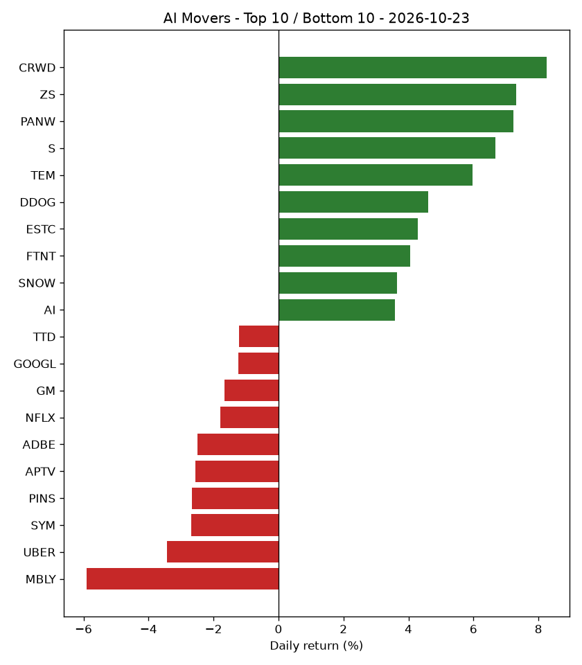

# AI Market Recap - 2026-10-23

## Market Overview

Market breadth was positive with 31 stocks up, 18 down, and 1 flat out of 50 total stocks tracked, while the S&P 500 (SPY) returned -0.52%.

## Top Themes

Cybersecurity AI led top themes with a +6.70% gain as it moved from rank 9 to rank 1, while AI Data & Analytics gained +3.72% to move from rank 10 to rank 2.

| Theme | Return | 5d Trend | Rank | Prev Rank |
|---|---|---|---|---|
| Cybersecurity AI | +6.70% | +13.04% | 1 | 9 |
| AI Data & Analytics | +3.72% | +9.37% | 2 | 10 |
| Healthcare AI | +1.32% | +4.77% | 3 | 4 |
| AI Chips & Semiconductors | +1.07% | -0.40% | 4 | 7 |
| AI Networking & Data Center Infrastructure | +0.53% | -2.28% | 5 | 5 |

## Bottom Themes

Autonomous Vehicles & Mobility AI was the weakest theme with a -2.84% return, dropping from rank 1 to rank 10.

| Theme | Return | 5d Trend | Rank | Prev Rank |
|---|---|---|---|---|
| Autonomous Vehicles & Mobility AI | -2.84% | -4.82% | 10 | 1 |
| Consumer Internet & AI Platforms | -1.31% | +0.45% | 9 | 6 |
| Enterprise AI Software | -0.33% | +7.73% | 8 | 8 |
| Cloud & AI Infrastructure | -0.09% | -0.01% | 7 | 3 |
| Robotics & Industrial Automation | +0.31% | +1.04% | 6 | 2 |

## Top Stocks

CRWD was the top-performing stock with a +8.25% return, climbing from rank 42 to rank 1, while ZS gained +7.31% to move from rank 38 to rank 2.

| Ticker | Theme | Return | 5d Trend | High | Low | Volume | Rank | Prev Rank |
|---|---|---|---|---|---|---|---|---|
| CRWD | Cybersecurity AI | +8.25% | +13.27% | $257.91 | $234.79 | 13,393,905 | 1 | 42 |
| ZS | Cybersecurity AI | +7.31% | +23.04% | $255.55 | $234.19 | 3,988,622 | 2 | 38 |
| PANW | Cybersecurity AI | +7.22% | +11.27% | $381.49 | $351.24 | 6,587,940 | 3 | 46 |
| S | Cybersecurity AI | +6.67% | +11.21% | $24.07 | $22.30 | 18,429,327 | 4 | 47 |
| TEM | Healthcare AI | +5.96% | +4.47% | $68.14 | $62.67 | 4,688,195 | 5 | 50 |
| DDOG | AI Data & Analytics | +4.62% | +9.12% | $273.42 | $254.59 | 2,239,804 | 6 | 44 |
| ESTC | AI Data & Analytics | +4.30% | +11.65% | $102.68 | $97.00 | 2,111,726 | 7 | 37 |
| FTNT | Cybersecurity AI | +4.05% | +6.42% | $180.16 | $171.19 | 3,224,922 | 8 | 43 |
| SNOW | AI Data & Analytics | +3.65% | +6.06% | $325.62 | $310.31 | 3,164,602 | 9 | 49 |
| AI | AI Data & Analytics | +3.57% | +10.07% | $12.50 | $11.83 | 5,850,364 | 10 | 41 |

## Bottom Stocks

MBLY was the lowest-performing stock with a -5.90% return, falling from rank 22 to rank 50, while UBER declined -3.43% to drop from rank 10 to rank 49.

| Ticker | Theme | Return | 5d Trend | High | Low | Volume | Rank | Prev Rank |
|---|---|---|---|---|---|---|---|---|
| MBLY | Autonomous Vehicles & Mobility AI | -5.90% | -9.42% | $6.88 | $6.40 | 13,252,108 | 50 | 22 |
| UBER | Autonomous Vehicles & Mobility AI | -3.43% | -5.19% | $68.90 | $66.43 | 18,765,010 | 49 | 10 |
| SYM | Robotics & Industrial Automation | -2.68% | +1.32% | $40.30 | $38.90 | 1,598,302 | 48 | 20 |
| PINS | Consumer Internet & AI Platforms | -2.66% | +1.87% | $23.05 | $22.21 | 9,603,988 | 47 | 26 |
| APTV | Autonomous Vehicles & Mobility AI | -2.56% | -4.84% | $43.34 | $41.88 | 2,993,803 | 46 | 5 |
| ADBE | Enterprise AI Software | -2.49% | +7.59% | $271.50 | $262.78 | 3,083,925 | 45 | 21 |
| NFLX | Consumer Internet & AI Platforms | -1.79% | -6.64% | $67.82 | $65.78 | 37,842,155 | 44 | 23 |
| GM | Autonomous Vehicles & Mobility AI | -1.67% | -9.58% | $76.18 | $74.59 | 6,713,500 | 43 | 2 |
| GOOGL | Cloud & AI Infrastructure | -1.24% | -5.98% | $324.53 | $320.18 | 17,562,782 | 42 | 19 |
| TTD | Consumer Internet & AI Platforms | -1.22% | +6.30% | $13.11 | $12.84 | 13,021,027 | 41 | 40 |

